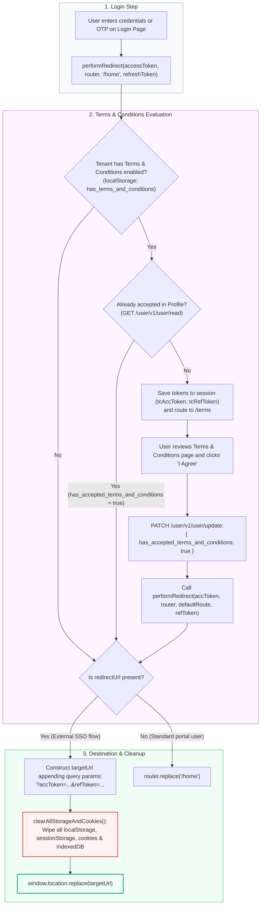

# Authentication & Redirect Flow

---

### Redirection Summary

1. **Login Step**: User authenticates with password or OTP; tokens are passed to `performRedirect`.
2. **Terms Evaluation**:
   - If tenant requires Terms & Conditions and the user has not accepted them (`has_accepted_terms_and_conditions === false`), they are routed to `/terms`.
   - Once the user clicks **"I Agree"**, `PATCH /user/v1/user/update` updates profile acceptance, and `performRedirect` is called again.
3. **Destination & Storage Clearing**:
   - If `redirectUrl` is present: Appends `accToken` and `refToken` to the URL, runs `clearAllStorageAndCookies()` (clearing `localStorage`, `sessionStorage`, cookies, and `IndexedDB`), and navigates to the target URL via `window.location.replace`.
   - If no `redirectUrl`: Navigates to `/home` via `router.replace`.
